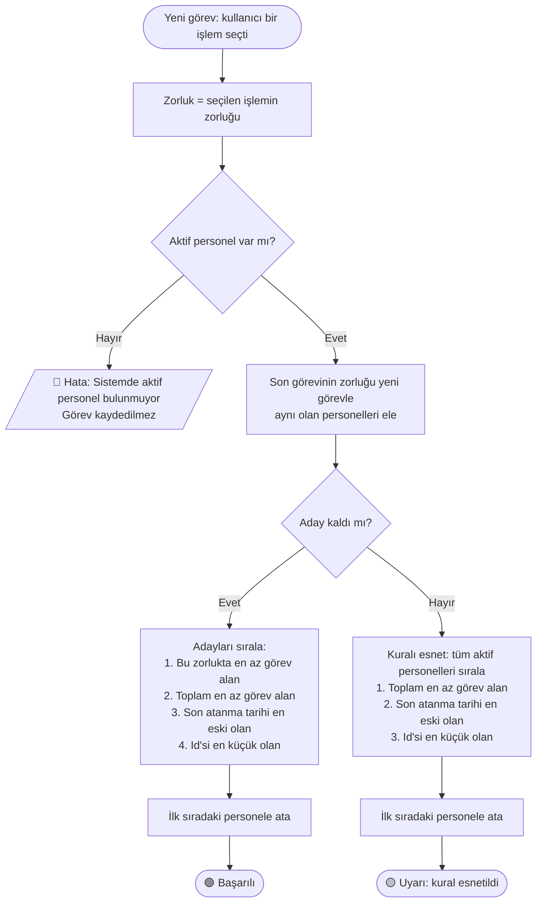
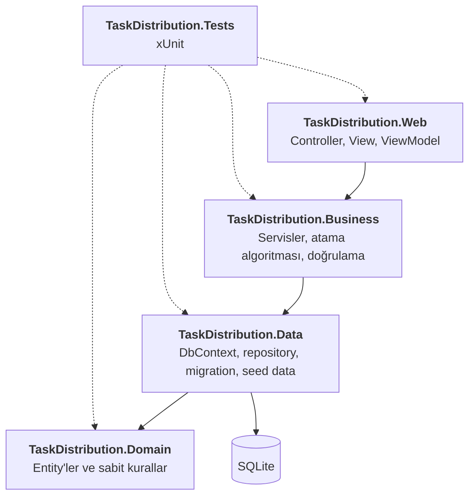
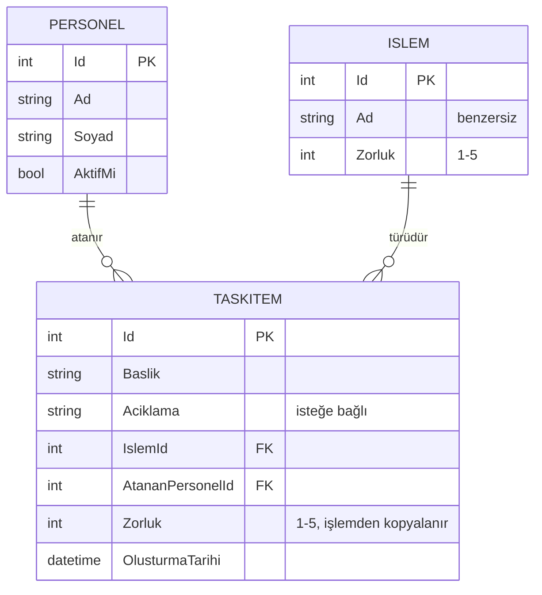

# Task Distribution

Kullanıcıların oluşturduğu görevleri, seçilen işlemin zorluk seviyesine (1–5) göre personellere **otomatik ve adil** şekilde dağıtan bir ASP.NET Core MVC uygulaması.

Görev oluşturulduğu anda sistem, kurallara göre en uygun personeli seçer. Aynı personele art arda aynı zorlukta görev verilmez, her zorluk seviyesindeki iş yükü personeller arasında dengelenir. Uygun aday bulunamazsa kural esnetilir ve kullanıcı uyarılır.

## İçindekiler

- [Özellikler](#özellikler)
- [Teknolojiler](#teknolojiler)
- [Kurulum ve Çalıştırma](#kurulum-ve-çalıştırma)
- [Atama Algoritması](#atama-algoritması)
- [Mimari](#mimari)
- [Veri Modeli](#veri-modeli)
- [Başlangıç Verisi](#başlangıç-verisi)
- [Testler](#testler)
- [Proje Yapısı](#proje-yapısı)
- [Tasarım Kararları](#tasarım-kararları)

## Özellikler

- **Görev oluşturma ve otomatik atama:** Kullanıcı başlık, açıklama ve işlem seçer. Görev kaydedildiği anda bir personele atanır.
- **Zorluk işlemden gelir:** Görevin zorluğu seçilen işlemin zorluğundan otomatik alınır ve kullanıcı tarafından değiştirilemez. Formda zorluk alanı yoktur, sunucu zorluğu her zaman veritabanındaki işlemden okur.
- **Üç renkli geri bildirim:**
  - 🟢 Normal atama
  - 🟡 Kural esnetilerek yapılan atama
  - 🔴 Aktif personel olmadığı için atama yapılamadı (görev kaydedilmez)
- **Görev dağılımı tablosu:** Ana sayfada her personelin her zorlukta kaç görev aldığı, toplam görev sayısı ve son görevi görünür.
- **Personel yönetimi (CRUD):** Listeleme, ekleme, düzenleme, silme ve aktif/pasif yapma. Pasif personele görev atanmaz. Görev geçmişi bozulmasın diye görevi olan personel silinemez; bunun yerine pasif yapılabilir.
- **İşlem listesi:** Görevlerde seçilebilecek iş türleri ve zorlukları.
- **Loglama:** Her atama ve kuralın esnetildiği durumlar sunucu kayıtlarına yazılır.

## Teknolojiler

| Alan | Teknoloji |
|---|---|
| Dil ve platform | C#, .NET 8 |
| Web | ASP.NET Core MVC, Razor |
| ORM | Entity Framework Core 8 (code-first, migration) |
| Veritabanı | SQLite |
| Arayüz | Bootstrap 5 |
| Test | xUnit |

## Kurulum ve Çalıştırma

**Gereksinim:** [.NET 8 SDK](https://dotnet.microsoft.com/download/dotnet/8.0). Proje .NET 9 veya daha yeni bir SDK ile de derlenebilir; çalıştırmak için bilgisayarda .NET 8 runtime bulunmalıdır.

```bash
git clone https://github.com/birgulskll/TaskDistribution.git
cd TaskDistribution
dotnet run --project src/TaskDistribution.Web
```

Ardından tarayıcıda **http://localhost:5256** adresini aç.

- Veritabanı (`src/TaskDistribution.Web/taskdistribution.db`) ilk açılışta **otomatik oluşturulur**, migration'lar uygulanır ve başlangıç verisi eklenir. Elle bir komut çalıştırmaya gerek yoktur.
- Veritabanını sıfırlamak için uygulamayı kapatıp `taskdistribution.db` dosyasını silmen yeterlidir. Bir sonraki açılışta yeniden oluşturulur.

### Testleri çalıştırma

```bash
dotnet test
```

### Yeni migration oluşturma (geliştiriciler için)

`dotnet-ef` aracı projeye yerel araç (local tool) olarak eklenmiştir:

```bash
dotnet tool restore
dotnet ef migrations add MigrationAdi --project src/TaskDistribution.Data
```

## Atama Algoritması

Algoritma [`AtamaService`](src/TaskDistribution.Business/Services/AtamaService.cs) sınıfındadır. Veritabanına bağımlı değildir; personel listesi ve görev geçmişi üzerinde çalışır. Bu sayede her kuralı ayrı ayrı test etmek kolaydır.



### Kurallar

1. **Yalnızca aktif personeller** değerlendirilir.
2. **Ardışık zorluk kuralı:** Son görevinin zorluğu yeni görevle aynı olan personel elenir. Hiç görevi olmayan personel her zaman adaydır.
3. Kalan adaylar arasından **ilgili zorlukta en az görev almış** personel seçilir.
4. **Eşitlik durumunda** sırasıyla şunlara bakılır:
   1. Toplam görev sayısı en az olan
   2. Son atanma tarihi en eski olan (hiç görev almamış personel en öne geçer)
   3. Id'si en küçük olan
5. **Hiç aday kalmazsa** ardışık zorluk kuralı esnetilir: tüm aktif personeller arasından toplam görev sayısı en az olan seçilir ve kullanıcıya uyarı gösterilir.
6. **Aktif personel yoksa** görev kaydedilmez ve anlamlı bir hata mesajı gösterilir.

"Son görev", oluşturma tarihi en yeni olan görevdir. Tarihler eşitse Id'si büyük olan görev sayılır.

### Örnek

Yeni görevin zorluğu **3** olsun:

| Personel | Durum | Son görev zorluğu | 3. zorluktaki görev | Toplam görev | Sonuç |
|---|---|---|---|---|---|
| Ayşe | Pasif | – | 0 | 0 | Elenir (pasif) |
| Mehmet | Aktif | **3** | 1 | 2 | Elenir (son görevi 3) |
| Zeynep | Aktif | 1 | 1 | 4 | Aday |
| Ali | Aktif | 2 | 1 | 3 | **Seçilir** (Zeynep ile eşit, toplamı daha az) |

## Mimari

Proje beş katmandan oluşur. Bağımlılıklar **tek yönlüdür**: üst katman alt katmanı tanır, alt katman üst katmanı tanımaz.



| Katman | Sorumluluk |
|---|---|
| **Domain** | `Personel`, `Islem`, `TaskItem` entity'leri. Zorluk (1–5) ve alan uzunluğu kuralları tek yerde (`ZorlukSeviyesi`, `AlanUzunluklari`). Hiçbir projeye bağımlı değildir. |
| **Data** | EF Core `AppDbContext`, Fluent API ayarları, check constraint'ler, migration'lar, seed data ve repository'ler. EF Core sadece bu katmanda kullanılır. |
| **Business** | `AtamaService` (algoritma), `GorevService` (görev oluşturma akışı), `PersonelService`, `IslemService`, `OzetService`. Doğrulama ve iş kuralları burada. |
| **Web** | Controller'lar, Razor view'lar ve ViewModel'ler. Controller'lar **DbContext'i veya repository'leri hiç görmez**, sadece servis arayüzlerini kullanır. |
| **Tests** | Domain, repository, servis, algoritma ve controller testleri. |

Servisler .NET'in Dependency Injection sistemiyle kaydedilir. Web projesi tek satırla tüm katmanları kaydeder:

```csharp
builder.Services.AddBusinessLayer(connectionString);
```

## Veri Modeli



- `TaskItem.Zorluk`, görev oluşturulduğu andaki işlem zorluğunun **kopyasıdır**. İşlemin zorluğu ileride değişse bile eski görevlerin zorluğu bozulmaz.
- Zorluk hem C# tarafında hem de veritabanında (check constraint) 1–5 aralığıyla sınırlandırılmıştır.
- Görevi olan bir personel veya işlem silinemez (`DeleteBehavior.Restrict`).

## Başlangıç Verisi

İlk açılışta veritabanına 8 personel ve zorlukları 1–5 arasında değişen 8 işlem eklenir.

| İşlem | Zorluk |
|---|---|
| Doküman Güncelleme | 1 |
| Hata Kaydı İnceleme | 1 |
| Arayüz Düzenleme | 2 |
| Birim Test Yazma | 2 |
| Raporlama Ekranı | 3 |
| Veritabanı Optimizasyonu | 4 |
| Entegrasyon Geliştirme | 4 |
| Mimari Tasarım | 5 |

**Personeller:** Ayşe Yılmaz, Mehmet Kaya, Zeynep Demir, Ali Çelik, Elif Şahin, Burak Arslan, Selin Koç, Emre Aydın (hepsi aktif).

## Testler

Toplam **95 test** vardır.

| Alan | Test sayısı | Neyi kapsıyor? |
|---|---|---|
| Domain | 22 | Zorluk sınırları (1–5), entity varsayılanları ve ilişkiler |
| Data | 19 | Seed data, check constraint, silme koruması, repository sorguları (bellek içi SQLite) |
| Business | 38 | Atama algoritmasının her kuralı, servis doğrulamaları, personel silme kuralı, uçtan uca dağıtım, özet tablosu, DI kayıtları |
| Web | 16 | Controller davranışları: doğrulama, silme onayı, yönlendirme, başarı/uyarı/hata mesajları (sahte servislerle) |

Öne çıkan testler:

- `AtamaServiceTests`: Algoritmanın her kuralı ve eşitlik durumu için ayrı test.
- `GorevServiceTests.AyniZorlukta8Gorev_8FarkliPersoneleAdilceDagitilir`: Aynı zorlukta 8 görevin 8 farklı personele birer birer dağıtıldığını gerçek veritabanıyla doğrular.
- `AppDbContextTests.Veritabani_GecersizZorlukDegeriniReddetmeli`: C# kontrolü atlanıp doğrudan SQL ile geçersiz zorluk yazılmaya çalışıldığında veritabanının bunu reddettiğini doğrular.

Veritabanı testleri, her test için bellekte sıfırdan oluşturulan bir SQLite veritabanında çalışır ve gerçek migration'ları kullanır.

## Proje Yapısı

```
TaskDistribution/
├── src/
│   ├── TaskDistribution.Domain/
│   │   ├── Constants/          # ZorlukSeviyesi, AlanUzunluklari
│   │   └── Entities/           # Personel, Islem, TaskItem
│   ├── TaskDistribution.Data/
│   │   ├── Configurations/     # Fluent API ayarları ve seed data
│   │   ├── Migrations/         # EF Core migration'ları
│   │   ├── Repositories/       # Repository arayüzleri ve sınıfları
│   │   ├── AppDbContext.cs
│   │   └── DependencyInjection.cs
│   ├── TaskDistribution.Business/
│   │   ├── Helpers/            # Ortak görev geçmişi kuralları
│   │   ├── Models/             # AtamaSonucu, ServisSonucu, PersonelOzeti
│   │   ├── Services/           # AtamaService, GorevService, PersonelService, ...
│   │   └── DependencyInjection.cs
│   └── TaskDistribution.Web/
│       ├── Controllers/        # Home, Gorev, Personel, Islem
│       ├── Helpers/            # Bildirim anahtarları, zorluk görünümü
│       ├── ViewModels/         # Form modelleri
│       ├── Views/
│       └── wwwroot/
└── tests/
    └── TaskDistribution.Tests/
        ├── Domain/
        ├── Data/
        ├── Business/
        └── Web/
```

## Tasarım Kararları

- **Algoritma veritabanından bağımsız:** `AtamaService` sadece bir personel listesi alır ve karar verir. Veriyi getirme ve kaydetme işi `GorevService`'tedir. Bu sayede algoritma hızlı ve kolay test edilir.
- **Zorluk sunucuda belirlenir:** `GorevService.OlusturAsync` metodu zorluk parametresi almaz. Kullanıcı formu değiştirse bile zorluğu gönderebileceği bir yol yoktur.
- **Hata yerine sonuç nesnesi:** "Aktif personel yok" gibi beklenen durumlar exception değil `AtamaSonucu` / `ServisSonucu` ile bildirilir. Exception yalnızca programlama hataları (örneğin geçersiz zorluk) için kullanılır.
- **Kurallar tek yerde:** Zorluk sınırları ve alan uzunlukları Domain'deki sabitlerde tanımlıdır. Veritabanı ayarları, servis doğrulamaları ve form doğrulamaları aynı değerleri kullanır.
- **Form modelleri (ViewModel):** Formlar entity yerine ViewModel kullanır. Böylece formdan yalnızca beklenen alanlar alınır (overposting koruması).
- **Post-Redirect-Get:** Kayıt işlemlerinden sonra sayfaya yönlendirme yapılır ve mesajlar `TempData` ile taşınır. Sayfa yenilendiğinde form tekrar gönderilmez.
