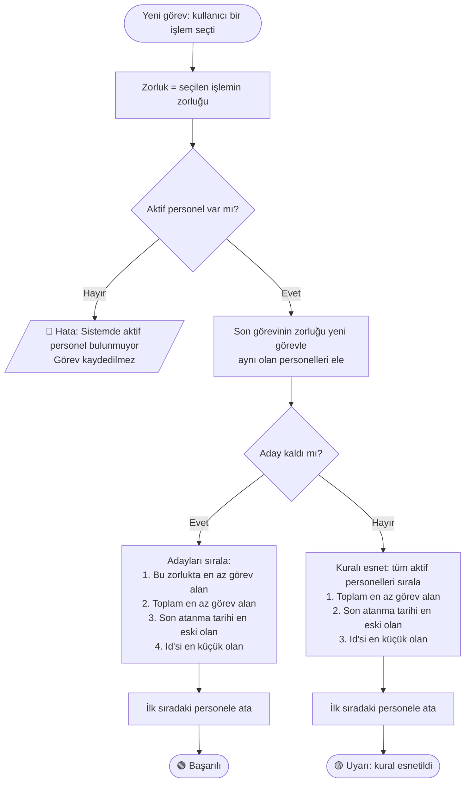
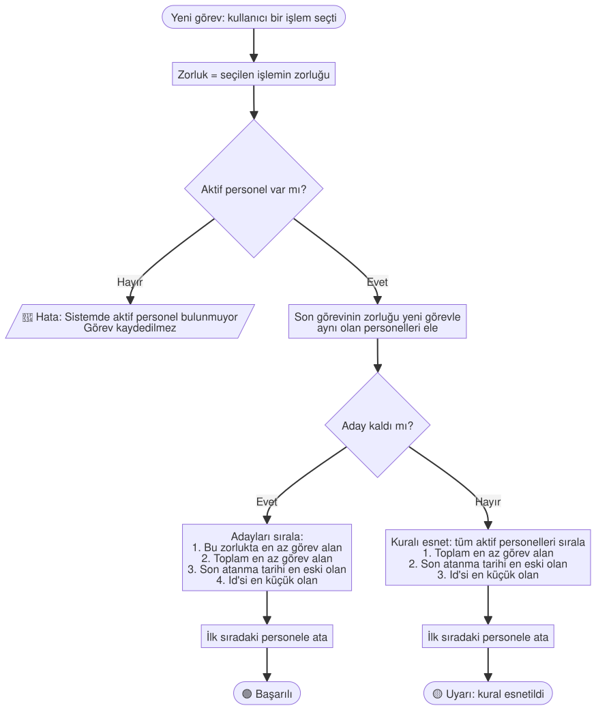

# Atama Algoritması – Akış Şeması

Bu belge, yeni bir görev oluşturulduğunda **uygun developer'ın (personelin) sistem tarafından nasıl belirlendiğini** anlatır.

- Kod: [`src/TaskDistribution.Business/Services/AtamaService.cs`](../src/TaskDistribution.Business/Services/AtamaService.cs)
- Testler: [`tests/TaskDistribution.Tests/Business/AtamaServiceTests.cs`](../tests/TaskDistribution.Tests/Business/AtamaServiceTests.cs)

## Akış Şeması

Şemanın resim (SVG) hali, Mermaid desteklemeyen ortamlarda da açılabilir: [atama-algoritmasi.svg](atama-algoritmasi.svg)

## Adımlar

| Adım | Ne yapılır? | Neden? |
|---|---|---|
| 1. Zorluğu belirle | Görevin zorluğu, seçilen işlemin zorluğundan alınır. Kullanıcı zorluğu değiştiremez. | Zorluk analizini işlem tipleri belirler; aynı işlem her zaman aynı zorluktadır. |
| 2. Aktif personeller | Sadece aktif personeller değerlendirilir. Hiç aktif personel yoksa görev kaydedilmez ve hata mesajı gösterilir. | İzinli veya görevden ayrılmış personele iş atanmamalı. |
| 3. Ardışık zorluk kuralı | Son aldığı görevin zorluğu, yeni görevin zorluğuyla aynı olan personeller elenir. Hiç görev almamış personel her zaman adaydır. | Aynı personele art arda aynı zorlukta görev verilmemeli. |
| 4. Sıralama | Kalan adaylar sırayla şu kriterlere göre sıralanır: bu zorlukta en az görev alan → toplam en az görev alan → son atanma tarihi en eski olan → Id'si en küçük olan. | Her zorluk seviyesindeki iş yükü personeller arasında dengelenir. Eşitlikte en az yüklü ve en uzun süredir boşta olan seçilir. |
| 5. Kuralın esnetilmesi | Hiç aday kalmazsa ardışık zorluk kuralı esnetilir: tüm aktif personeller arasından toplam görevi en az olan seçilir ve kullanıcıya **uyarı** gösterilir. | Görev atanmadan kalmamalı; kuralın esnetildiği kullanıcıdan gizlenmemeli. |

**"Son görev" tanımı:** Oluşturma tarihi en yeni olan görev. Tarihler eşitse Id'si büyük olan görev sayılır.

## Örnek Senaryolar

Başlangıçta 8 aktif personelin hiç görevi yok.

| Sıra | Yeni görevin zorluğu | Seçilen | Neden? |
|---|---|---|---|
| 1 | 5 | Personel 1 | Herkes eşit; Id'si en küçük olan seçildi. |
| 2 | 5 | Personel 2 | Personel 1'in son görevi de 5 olduğu için elendi. Kalanlar eşit; Id'si en küçük olan seçildi. |
| 3 | 1 | Personel 3 | Personel 1 ve 2'nin toplam görevi 1. Görevi olmayanlar arasından Id'si en küçük olan seçildi. |

**Kuralın esnetildiği durum:** Sadece Personel 1 aktif ve son görevi 3. zorlukta olsun. Yeni görev de 3. zorluktaysa aday kalmaz. Kural esnetilir, görev yine Personel 1'e atanır ve kullanıcıya sarı uyarı gösterilir.

**Aktif personel yoksa:** Görev kaydedilmez, kullanıcıya *"Sistemde aktif personel bulunmuyor. Görev atanamadı."* hatası gösterilir.
